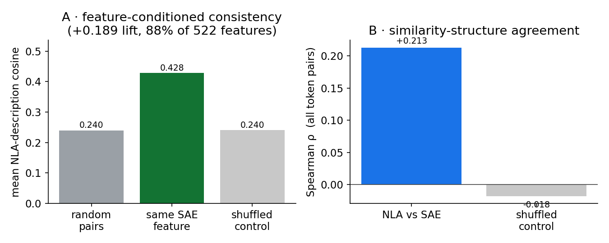
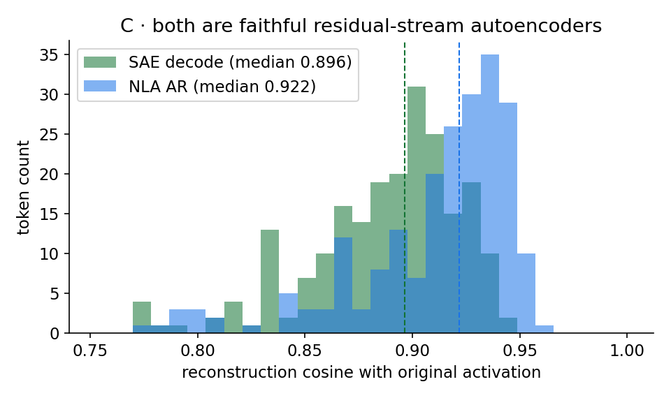

# Do Natural-Language Autoencoders and Sparse Autoencoders Agree? A Pilot Comparison on Qwen2.5-7B

**Steven Hou**
July 2026

---

## Abstract

Two families of unsupervised method now claim to explain what a language model
represents in its residual stream, and they do it in completely different media.
A **sparse autoencoder (SAE)** decomposes an activation into a sparse
overcomplete code of learned features. A **natural-language autoencoder (NLA)**
verbalizes the *same* activation into a free-text English description and is
trained to make that description sufficient to reconstruct the vector. Because
the two are trained independently, with different objectives and different
output spaces, we can ask a convergent-validity question: **on the same
activations, do they recover the same structure?** Using the open NLA release
for `Qwen2.5-7B-Instruct` and an open SAE trained on the same model, we compare
them on 216 residual-stream token activations. We find clear agreement. Tokens
that share an SAE feature are described **≈79% more similarly by the NLA** than
random token pairs (cosine lift +0.189 over a 0.240 baseline; 88% of 522
features show a positive lift; a shuffled control sits at +0.0006). Global
pairwise-similarity structure also tracks between the two methods (Spearman
ρ = 0.213 vs a shuffled control of −0.018). Both are faithful autoencoders of
the stream (median reconstruction cosine 0.90 for the SAE decoder, 0.92 for the
NLA reconstructor). This is a small pilot — one model, one layer, 216 tokens —
but it is direct evidence that the structure these methods surface lives in the
model, not in the method.

---

## 1. Introduction

Mechanistic interpretability has converged on the residual stream of a
transformer as the object to explain, and on *autoencoding* as the way to
explain it: learn a map from an activation to some human-legible representation
and back, and use the reconstruction error to certify that the legible
representation kept the content.

Two such methods have very different codomains:

- **Sparse autoencoders (SAEs)** map an activation `h ∈ ℝ^d` to a sparse
  nonnegative code over an overcomplete dictionary, then decode. Each active
  coordinate is a "feature," and features are meant to be monosemantic. SAEs are
  now available at scale for open models (e.g. Gemma Scope).
- **Natural-language autoencoders (NLAs)** map `h` to a short English
  description via a fine-tuned *activation verbalizer* (AV), and map the
  description back to a vector via an *activation reconstructor* (AR). The AV/AR
  pair is trained so that the words alone are enough to recover `h`.

Both are unsupervised and both are validated by reconstruction, but they
decompose the stream into different things — a discrete sparse code vs a
paragraph of English. If both are recovering something real about the model,
their outputs should *agree*: activations the SAE places together should get
similar NLA descriptions, and vice versa. If instead each is largely an artifact
of its own inductive bias, their outputs would be uncorrelated once we control
for chance. This paper runs that test.

The comparison became possible only recently: an open NLA release
([kitft](https://github.com/kitft/natural_language_autoencoders), accompanying
Anthropic's *Natural Language Autoencoders* work) ships trained AV/AR
checkpoints for `Qwen2.5-7B-Instruct`, and an open SAE for the *same* model is
available ([`andyrdt/saes-qwen2.5-7b-instruct`](https://huggingface.co/andyrdt/saes-qwen2.5-7b-instruct)).

## 2. Setup

**Target model.** `Qwen/Qwen2.5-7B-Instruct` (28 layers, `d = 3584`).

**NLA.** `kitft/nla-qwen2.5-7b-L20-av` (verbalizer) and `-ar` (reconstructor).
The NLA reads the residual stream at "layer 20," which the release documents as
HF `hidden_states[21]` (the output of block 20). The AV injects the activation
as a single token embedding (L2-renormalized to `injection_scale = 150`) into a
fixed prompt and autoregresses an `<explanation>`; we decode greedily
(temperature 0) for reproducibility. The AV is served with SGLang via its
`input_embeds` path. The AR is a truncated LM plus a linear head giving a
reconstruction cosine.

**SAE.** `andyrdt/saes-qwen2.5-7b-instruct`, `resid_post_layer_19`, trainer 0: a
BatchTopK SAE with dictionary size 131,072, `k = 32`, inference threshold 3.51.
`resid_post_layer_19` is HF `hidden_states[20]` (the output of block 19).

**Layer alignment.** The two methods read **adjacent** points in the stream: the
NLA at `hidden_states[21]`, the SAE at `hidden_states[20]` — exactly one block
apart. We extract both in a single forward pass and feed each method its native
layer. The one-block offset is a genuine confound and is discussed in §5.

**Data.** 36 short English paragraphs spanning ~18 topics (biology, law,
cooking, finance, sport, code, history, music, weather, medicine, geology,
myth, ML, wine, astronomy, chess, …). We run each paragraph through the model
and take activations at up to 6 evenly spaced token positions per paragraph,
skipping the first 12 positions (early positions verbalize poorly) and any
position with residual norm outside [30, 300] (rare out-of-distribution spikes).
This yields **N = 216** token activations.

## 3. Method

For each of the N tokens we obtain, from the *same* forward pass:

- an **NLA description** `t_i` (English), from the AV at `hidden_states[21]`;
- an **SAE code** `f_i ∈ ℝ_{≥0}^{131072}` (sparse), from the SAE at
  `hidden_states[20]`;
- an **SAE reconstruction cosine** `cos(h_i, dec(f_i))`;
- an **NLA reconstruction cosine** `cos(h_i, AR(t_i))`.

We embed each NLA description with `all-MiniLM-L6-v2` (mean-pooled,
L2-normalized) to get `e_i ∈ ℝ^{384}`, and define two similarity matrices over
tokens: `S^text_{ij} = ⟨e_i, e_j⟩` (agreement in NLA-description space) and
`S^sae_{ij} = cos(f_i, f_j)` (agreement in SAE-feature space). All results use
label-free comparisons — we never need a human name for an SAE feature.

**(A) Feature-conditioned NLA consistency.** For every SAE feature that fires on
at least 3 of the 216 tokens (522 such features), let `T_f` be its firing set.
We compute the mean pairwise NLA-description similarity *within* `T_f` and the
lift over the global baseline `b = mean_{i<j} S^text_{ij}`:

```
lift(f) = mean_{i<j ∈ T_f} S^text_{ij}  −  b
```

We report the mean lift over features, the fraction of features with positive
lift, and a **shuffled control** that permutes the NLA embeddings across tokens
and recomputes the same quantity (which should give ≈0). This directly asks:
*do tokens the SAE groups together get similar NLA descriptions?*

**(B) Similarity-structure agreement.** Over all `C(216,2) = 23,220` token
pairs we compute the Spearman rank correlation between `S^text` and `S^sae`, and
a shuffled control that permutes one matrix's token indices. This asks whether
the two methods induce the *same geometry* over activations.

**(C) Autoencoder fidelity.** Median SAE decoder cosine vs median NLA AR cosine,
a head-to-head on how much of the activation each method's round-trip preserves.

## 4. Results



**The methods agree.**

| Test | Result | Shuffled control |
|---|---|---|
| **A · feature-conditioned NLA consistency** | mean lift **+0.189** (within-feature 0.429 vs 0.240 baseline; **88%** of 522 features positive) | **+0.0006** |
| **B · similarity-structure agreement** | Spearman **ρ = 0.213** (over 23,220 pairs) | **−0.018** |
| **C · autoencoder fidelity** | SAE decode **0.896** / NLA AR **0.922** (median cosine) | — |

Test A is the strongest and cleanest signal: conditioning on a shared SAE
feature raises the expected NLA-description similarity by about 79% over chance,
for the large majority of features, while destroying the token↔description
pairing (the shuffled control) removes essentially all of it. Test B is a weaker
but clearly positive global correlation — expected, since it is an all-pairs
correlation across two methods operating at different granularities and one
block apart. Test C shows neither method is agreeing by discarding content:
both round-trips preserve ~90% of the activation direction.



**Qualitative.** Topic-concentrated SAE features — ones that fire on several
tokens drawn from a single subject — are described by the NLA, which never saw
the SAE, as that same subject:

| SAE feature | fires on | NLA describes the tokens as |
|---|---|---|
| #87467 | 12 tokens (biology docs) | "biology / cellular respiration / biochemistry" |
| #78345 | 8 tokens (rainforest doc) | "the Amazon Rainforest / nature science journalism" |
| #30775 | 7 tokens (geology docs) | "mountain formation / earthquake science" |
| #106527 | 7 tokens (wine doc) | "winemaking / vineyard / fermentation" |
| #121136 | 6 tokens (contract-law doc) | "contract formation / legal definition / consideration" |
| #118684 | 6 tokens (4th-Amendment doc) | "Fourth Amendment / constitutional law" |

(The most *frequent* SAE features are instead syntactic/positional — e.g. one
fires on sentence-final periods across every topic. These carry no topic signal
and contribute ≈0 to Test A, so the +0.189 lift is if anything conservative.)

## 5. Limitations

This is a pilot; the honest caveats matter.

- **Scale.** N = 216 tokens from 36 short paragraphs. Enough for a clear effect
  with a control, not enough for tight confidence intervals per feature.
- **One-block layer offset.** The NLA reads `hidden_states[21]` and the SAE
  reads `hidden_states[20]`; there is no open SAE at the NLA's exact layer. The
  streams are highly correlated one block apart, so the offset could both
  *attenuate* real agreement (different layers) and *inflate* it (shared
  information). A same-layer SAE would remove this confound.
- **Similarity proxy.** Test A/B use MiniLM cosine as the notion of
  "NLA-descriptions are similar." A different embedder would change magnitudes;
  the shuffled controls guard against spurious *structure* but not against the
  embedder's own biases.
- **Controls are single permutations,** not full permutation-test p-values. The
  observed effects sit far outside their single shuffled controls, but no formal
  significance is computed here.
- **Single model, single sparsity.** One SAE (`k = 32`); the repo ships k =
  32/64/128/256. One target model.
- **Qualitative support is approximate.** The feature→token grouping in the
  qualitative table is rebuilt post-hoc from each token's top-20 features (for
  illustration); the metrics use the full on-device active sets.
- **In-distribution prose only,** greedy NLA decoding, early/high-norm token
  positions filtered.

We claim only that the two methods **covary** far beyond chance — not that
either is "correct," nor that they are interchangeable.

## 6. Discussion

The result is a convergent-validity signal. Two decoders trained with unrelated
objectives — one producing a sparse code, one producing English — place
activations in agreeing arrangements. When independent methods agree, the
parsimonious explanation is that the agreed-upon structure is a property of the
model's representations rather than of either method's inductive bias. That is
useful in both directions: it is mild evidence that SAE features track
genuinely meaningful directions (they line up with an independent English
readout), and that NLA verbalizations are not free-associative confabulation
(they line up with an independent sparse decomposition).

The gap between the strong Test A and the modest Test B is itself informative.
Sharing a *specific* feature is a strong, local statement and yields a large
effect; a *global* rank correlation across all pairs mixes many features of
wildly different frequency (including uninformative syntactic ones) and across a
layer offset, so a smaller ρ is expected.

## 7. Future work

- Scale to 1–2k tokens and compute per-feature confidence intervals and a
  proper permutation-test p-value.
- Remove the layer confound: obtain/train an SAE at the NLA's exact readout, or
  use the SAE at layer 23 as a *controlled* offset in the other direction.
- Sweep SAE sparsity (k = 32/64/128/256, all in the repo) — does agreement rise
  with denser codes?
- Cross-embedder robustness for the similarity proxy; and a direct comparison
  of NLA descriptions against *auto-interp labels* of the SAE features.
- Repeat on the other open NLA targets (Gemma-3-12B/27B, Llama-3.3-70B).

## 8. Reproducibility

Everything runs serverlessly on [Modal](https://modal.com) on a single H100.
The full run (extract → SAE encode/decode → NLA verbalize 216 activations via
SGLang → NLA AR fidelity → metrics) takes ~10 minutes and cost **≈ $0.70**
(within Modal's monthly free credits; the container auto-scales to zero when
done).

```bash
pip install modal && modal setup
modal run code/probe.py          # cheap 3-stage integration check (2 activations)
modal run code/run.py            # full experiment -> results.json
python code/make_figures.py      # regenerate the figures from results.json
python code/regenerate_report.py # regenerate the browsable HTML report
```

Raw outputs are in [`results/results.json`](results/results.json) and a
browsable [`results/report.html`](results/report.html).

## References

- **Natural Language Autoencoders** — *Natural Language Autoencoders Produce
  Unsupervised Explanations of LLM Activations*, Transformer Circuits, 2026.
  <https://transformer-circuits.pub/2026/nla/> · code:
  <https://github.com/kitft/natural_language_autoencoders> · checkpoints:
  <https://huggingface.co/collections/kitft/nla-models>
- **SAE (used here)** — `andyrdt/saes-qwen2.5-7b-instruct`, BatchTopK residual
  SAEs for Qwen2.5-7B-Instruct.
  <https://huggingface.co/andyrdt/saes-qwen2.5-7b-instruct>
- **BatchTopK SAEs** — Bussmann, Leask, Nanda, *BatchTopK Sparse Autoencoders*,
  arXiv:2412.06410, 2024.
- **Gemma Scope** — Lieberum et al., *Gemma Scope: Open Sparse Autoencoders
  Everywhere All At Once on Gemma 2*, arXiv:2408.05147, 2024.
- **Sentence-BERT / MiniLM** — Reimers & Gurevych, *Sentence-BERT*,
  arXiv:1908.10084, 2019;
  `sentence-transformers/all-MiniLM-L6-v2`.
- **Auto-interpretability** — Bills et al., *Language models can explain neurons
  in language models*, OpenAI, 2023.
- **Target model** — Qwen Team, *Qwen2.5*, 2024.
  <https://huggingface.co/Qwen/Qwen2.5-7B-Instruct>

---

*Artifacts (NLA, SAE, model) are the work of their respective authors; this
study only compares them. Code and analysis in this repository are released
under the MIT License.*
