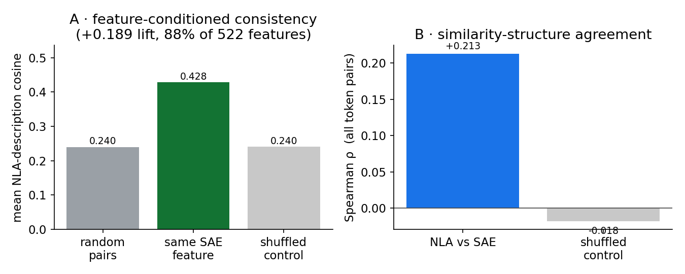

# NLA vs SAE — do two interpretability methods agree on the same activations?

> **Correction (2026-07-24):** a re-analysis found the headline Test-A lift
> (+0.189) is **mostly topical confound**, not feature-level agreement; the
> genuine result is the weaker Test-B structure correlation (ρ ≈ 0.21). The
> claims below have been amended — see [Results](#results). [PAPER.md](PAPER.md)
> predates this correction and still states the original claims.

A sparse autoencoder (**SAE**) explains a language-model activation as a sparse
code of learned features. A natural-language autoencoder (**NLA**) explains the
*same* activation as a short English description. They are trained
independently, with different objectives, into different output spaces. So: **on
the same activations, do they recover the same structure?**

Run on `Qwen2.5-7B-Instruct` (open NLA from [kitft](https://github.com/kitft/natural_language_autoencoders),
open SAE from [`andyrdt/saes-qwen2.5-7b-instruct`](https://huggingface.co/andyrdt/saes-qwen2.5-7b-instruct)),
over 216 residual-stream token activations — **a weak but statistically genuine
structure correlation (ρ ≈ 0.21); the larger headline lift does not survive a
topical-confound check.**



## Results

| Test | Result | What it actually shows |
|---|---|---|
| **A ·** tokens sharing an SAE feature get similar NLA descriptions | lift **+0.189** over 0.240 baseline, but only **+0.060** cross-document (see below) | **mostly topical confound** |
| **B ·** NLA-similarity structure tracks SAE-similarity structure | Spearman **ρ = 0.213** (23,220 pairs; permutation z = 6.6, p < 0.001; control −0.018) | **genuine but weak** — ~4% of rank variance |
| **C ·** both round-trips are faithful | SAE decode **0.90** / NLA AR **0.92** median cosine | **sanity check only** — each method reconstructs its *own* tensor, not cross-method agreement |

### Why Test A is mostly confound

The 216 tokens come from only 36 paragraphs — one topic each, six positions
each — so "shares an SAE feature" and "comes from the same paragraph" are
heavily entangled. 34% of the qualifying features fire entirely within a single
paragraph (their lift: +0.442), and those features contribute ~69% of the
headline lift. Restricted to cross-document within-feature pairs against a
cross-document baseline, the lift collapses from +0.212 to +0.060. The shuffled
control can't catch this: it permutes *all* tokens, destroying topical
clustering along with everything else, so it tests "any structure at all" and
cannot separate feature-level agreement from topical agreement. And the NLA
descriptions often quote the reconstructed context, which makes the MiniLM
embedding similarity highly topic-sensitive. The missing control is a
**within-document (topic-matched) shuffle** — that is the next step.

The qualitative table originally offered as support — topic-concentrated SAE
features matching NLA topic descriptions (biology, Amazon rainforest, geology,
winemaking, contract law, the Fourth Amendment) — is exactly what a topical
confound also produces: with one topic per paragraph, "same feature" and "same
document" are largely the same statement.

### What survives

Test B: the two similarity geometries correlate at ρ = 0.213 under a
token-level permutation test (z = 6.6, p < 0.001), and the correlation survives
partialling out same-document membership (0.192). But ρ ≈ 0.21 explains only
~4% of the rank variance — a weak-but-real correlation, not "agreement."

One further caveat: the NLA reads `hidden_states[21]` while the SAE was trained
on `hidden_states[20]`. Adjacent residual states are near-identical, so the
offset mildly *inflates* apparent agreement; no same-layer control was run.

📄 **Full write-up: [PAPER.md](PAPER.md)** (or the compilable
[`paper/paper.tex`](paper/paper.tex)) — written before the correction above;
its Test-A framing is superseded.

## Reproduce

Everything runs serverlessly on [Modal](https://modal.com) on one H100
(~10 min, ≈ $0.70, within the monthly free credits).

```bash
pip install modal && modal setup
modal run code/probe.py          # cheap integration check (2 activations)
modal run code/run.py            # full experiment -> results/results.json
python code/make_figures.py      # figures from results.json
python code/regenerate_report.py # browsable HTML report
```

## Layout

```
PAPER.md                 the paper (Markdown, renders on GitHub)
paper/paper.tex          LaTeX source (+ refs.bib) for a PDF
code/run.py              full experiment (Modal)
code/probe.py            3-stage integration probe (SAE / extraction / SGLang AV)
code/make_figures.py     figures from results.json
code/regenerate_report.py  HTML report from results.json
results/results.json     raw metrics + 216 per-token records
results/report.html      browsable report
figures/                 fig_agreement.png, fig_fidelity.png
```

## Method in one paragraph

For each token we take, from a single forward pass, the SAE at
`hidden_states[20]` (`resid_post_layer_19`) and the NLA at `hidden_states[21]`
("layer 20") — one block apart. The SAE gives a sparse feature code; the NLA
gives an English description, which we embed with `all-MiniLM-L6-v2`. Test A
asks whether tokens that fire a shared SAE feature have more-similar NLA
descriptions than random pairs (with a shuffled control — which, per the
correction above, cannot rule out the topical confound). Test B correlates the
two induced similarity geometries. All comparisons are **label-free** — no human
names for SAE features are needed. See [PAPER.md](PAPER.md) for the original
caveats (small N, the one-block layer offset, the MiniLM proxy,
single-permutation controls) and the correction note above for the one that
bites.

## Credits

The NLA (Anthropic / [kitft](https://github.com/kitft/natural_language_autoencoders)),
the SAE ([andyrdt](https://huggingface.co/andyrdt/saes-qwen2.5-7b-instruct)),
and the model (Qwen) are the work of their respective authors; this repo only
compares them. Code and analysis released under the [MIT License](LICENSE).
